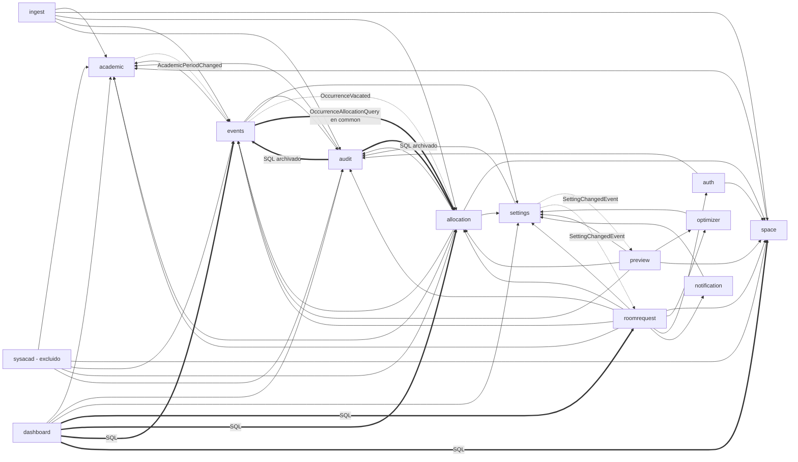

# Dimensión 1: Estructura y arquitectura

Commit auditado: `22c693f2`. Módulo `sysacad` excluido (solo aparece en el diagrama como
consumidor). Rutas relativas a `src/main/java/ar/edu/utn/frc/siga/` salvo que se indique otra.

## Método

- Orientación con graphify (`graphify query` sobre dependencias entre módulos y god nodes).
- Script propio de imports (`scratchpad/audit/tools/deps.py`): para cada `import` entre módulos
  verifica si el tipo destino tiene `@NamedInterface` o vive en un paquete marcado como tal.
  Resultado: 0 imports de tipos internos de otro módulo y 0 referencias por nombre calificado
  fuera de `common`.
- `ModularityTests` ya corrió en el hilo principal: `target/surefire-reports/ar.edu.utn.frc.siga.ModularityTests.txt`
  reporta `Tests run: 3, Failures: 0`, así que `ApplicationModules.verify()` pasa (sin ciclos ni
  accesos a tipos no expuestos a nivel de bytecode). El `Documenter` dejó los canvas en
  `target/spring-modulith-docs/`, y sus secciones "Events listened to" coinciden con la tabla de
  eventos de abajo.
- Entidades JPA: ninguna entidad de un módulo se importa desde otro. Las únicas clases de
  persistencia compartidas son `common.model.TimestampedEntity` y `SoftDeletableEntity`
  (`@MappedSuperclass`), que es el uso esperado de un módulo `OPEN`.
- Grafo de módulos a nivel de imports: acíclico. El orden topológico es
  `common → academic → audit → settings → {space, optimizer, notification} → events → {auth, dashboard}
  → allocation → {preview, ingest} → roomrequest`.

Lo que cumple la referencia de Spring Modulith 2.0 no se lista como hallazgo. Los hallazgos de
abajo son lo que `verify()` no puede ver o lo que la convención actual deja pasar.

## Diagrama de módulos

Flecha sólida: llamada directa a tipos `api`. Flecha punteada: evento de aplicación
(`@ApplicationModuleListener`). Flecha gruesa: acoplamiento oculto que `verify()` no detecta
(SQL directo sobre tablas de otro módulo o puerto en `common`). `common` se omite: todos dependen
de él.

## Eventos entre módulos

| Evento | Publica | Consume | Tipo de listener |
|---|---|---|---|
| `academic.event.AcademicPeriodChanged` | `academic` (`AcademicPeriodServiceImpl:156`) | `events` (`AcademicPeriodChangedListener:35`) | `@ApplicationModuleListener` |
| `events.model.OccurrenceVacated` | `events` (`OccurrenceServiceImpl:133`) | `allocation` (`OccurrenceVacatedListener:21`) | `@ApplicationModuleListener` |
| `settings.api.SettingChangedEvent` | `settings` (`SettingsStore:63`) | `preview` (`CaffeinePreviewStore:61`), `roomrequest` (`DirectEventSuggestionStore:34`, `RoomRequestSuggestionStore:34`) | `@ApplicationModuleListener` |
| `notification...NotificationsQueuedEvent` | `notification` | `notification` (interno) | `@TransactionalEventListener(AFTER_COMMIT)` |

Los cuatro eventos viajan en el mismo sentido que las dependencias de tipos o lo invierten de
forma legítima (`events` avisa a `allocation` sin depender de él). El registro de publicaciones
existe (`spring-modulith-starter-jpa`, tabla `event_publication` en `V1`), pero nada reprocesa
las publicaciones incompletas (ver ARQ-02).

## Fichas por módulo

Formato: responsabilidad / API expuesta (`@NamedInterface("api")`) / depende de / eventos /
`allowedDependencies`.

**academic** (74 archivos, 3061 líneas). Catálogo académico: especialidades, planes, materias,
comisiones, materia-comisión, períodos, feriados. API: 7 servicios (`SpecialtyService`,
`SubjectService`, `CommissionService`, `SubjectCommissionService`, `StudyPlanService`,
`AcademicPeriodService`, `HolidayService`), sus DTO de respuesta, 3 filtros, 5 comandos de sync,
`TermType`, `AcademicPeriodChanged`. Depende solo de `common`. Publica `AcademicPeriodChanged`.
`allowedDependencies = {common}`: coincide.

**space** (62, 2676). Aulas, edificios, tipos de aula, recursos y permisos por materia. API:
`ClassroomService`, `BuildingService`, 3 DTO, 2 comandos de sync. Depende de `academic`.
`allowedDependencies` declara también `settings`, que no usa (ARQ-09).

**settings** (22, 709). Parámetros editables en caliente con caché. API: paquete `api`
(`SettingsReader`, `SettingChangedEvent`) más `SettingKey`, `SettingType`, `RiskLevel` en
`model`. Depende de `audit`. Publica `SettingChangedEvent`. Coincide.

**audit** (56, 3246). Registro de auditoría con Envers, operaciones agrupadas, archivado. API: 5
tipos en el paquete raíz (`AuditOperation`, `AuditOperations`, `AuditCause`, `AuditedRecord`,
`AuditLabelProvider`), `RevisionReader`, `RevisionDto`, `RevisionKind`. Depende de `academic`
(ARQ-10). Coincide con lo declarado.

**auth** (50, 2055). Login JWT, usuarios, asignaciones de rol con alcance por edificio. API:
`UserService`, `UserResponseDto`, `SystemRole`, `SecurityUser`. Depende de `space`, `audit`.
Coincide.

**events** (53, 2645). Eventos académicos (recurrentes y únicos) y ocurrencias. API: 3 servicios
(`AcademicEventService`, `OccurrenceService`, `EventAuditHistoryService`), 13 DTO (incluye 3 DTO
de request HTTP), enums, `OccurrenceVacated`, 2 comandos de sync. Depende de `academic`, `audit`,
`settings`, y en tiempo de ejecución de `allocation` vía `common` (ARQ-01). Consume
`AcademicPeriodChanged`; publica `OccurrenceVacated`.

**allocation** (59, 2573). Asignación de aula a ocurrencias, conflictos, impacto, ocupación. API:
5 servicios, 4 comandos, 4 tipos de `validator`, 2 excepciones, `AllocationResponseDto`,
`AllocationSource`. Depende de `events`, `space`, `academic`, `audit`, `settings`. Consume
`OccurrenceVacated`. Implementa el puerto `common.service.OccurrenceAllocationQuery`. Coincide.

**optimizer** (25, 810). Motor Timefold puro. API: `OptimizerService` y 5 records de
entrada/salida. Depende de `settings`. Coincide.

**notification** (24, 723). Envío de correo con cola y reintentos. API: paquete `api` (6 tipos).
Todo lo demás en `internal`. Depende de `settings`. Evento interno `NotificationsQueuedEvent`.
Es el único módulo con la estructura `api`/`internal` completa.

**preview** (24, 1200). Previsualización y confirmación de asignación automática. No expone
nada (hoja). Depende de `allocation`, `events`, `optimizer`, `space`, `settings`. Consume
`SettingChangedEvent`. Declara `academic` sin usarlo (ARQ-09).

**ingest** (18, 736). Importación de planilla Excel. No expone nada. Depende de `academic`,
`space`, `allocation`, `events`, `audit`. Coincide.

**dashboard** (68, 2567). Tablero con snapshots diarios. No expone nada. Depende por imports de
`academic`, `settings`, `audit`, y por SQL de `roomrequest`, `allocation`, `events`, `space`
(ARQ-04).

**roomrequest** (113, 5560). Solicitudes de aula, derivación entre edificios, eventos directos,
sugerencias por optimizador, vencimiento. No expone nada. Depende de 9 módulos (ARQ-08). Consume
`SettingChangedEvent` dos veces. Coincide con lo declarado.

**common** (51, 1276, `OPEN`). Manejo de errores, contrato de permisos y alcance por edificio,
bases JPA, rate limit, utilidades. Contiene además tipos de dominio de agenda (ARQ-05).

## Hallazgos

### ARQ-01 Ciclo encubierto events → allocation a través de un puerto en common
- Severidad: Media
- Esfuerzo: S (<1h)
- Referencia: Spring Modulith 2.0, ciclos entre módulos y `@NamedInterface`; ISO 25010 Maintainability/Modularity
- Evidencia: `common/service/OccurrenceAllocationQuery.java:12`, `allocation/service/impl/OccurrenceAllocationQueryImpl.java:15`, `events/service/impl/RecurringEventReconciler.java:30`; `allocation/package-info.java:1` declara `events :: api`
- Verificación: Confirmado
- Problema: `allocation` depende de `events`, y `events` consulta a `allocation` (qué ocurrencias tienen aula) mediante una interfaz alojada en `common`, que es `OPEN`. El ciclo existe en tiempo de ejecución y `verify()` no lo ve porque el tipo vive en `common`; el Javadoc de la interfaz lo admite. La wiki (`Diseño/Arquitectura.md`, sección `common`) dice que `common` no tiene lógica de dominio.
- Arreglo: mover la interfaz a `events` como interfaz expuesta (por ejemplo `events/api/OccurrenceAllocationQuery` con `@NamedInterface("api")`). `allocation` ya depende de `events`, así que implementarla no agrega aristas y el sentido de la dependencia queda explícito y verificado.

### ARQ-02 Listeners de módulo sin reproceso de publicaciones incompletas
- Severidad: Media
- Esfuerzo: S (<1h)
- Referencia: Spring Modulith 2.0, Event Publication Registry (`IncompleteEventPublications`, `spring.modulith.events.republish-outstanding-events-on-restart`); ISO 25010 Reliability/Recoverability
- Evidencia: `pom.xml:229-230` (`spring-modulith-starter-jpa`); `grep -rn 'IncompleteEventPublications\|republish\|modulith' src/main` sin resultados; `allocation/service/impl/OccurrenceVacatedListener.java:21`. Consulta a `dev-snapshot`: `select listener_id, count(*), count(*) filter (where completion_date is null) from event_publication group by 1` devuelve 0 incompletas hoy.
- Verificación: Confirmado (configuración ausente); el impacto es Plausible porque hoy no hay incompletas
- Problema: si `OccurrenceVacatedListener` o `AcademicPeriodChangedListener` fallan (excepción, reinicio a mitad), la publicación queda incompleta en `event_publication` y nada la vuelve a disparar. En el caso de `OccurrenceVacated` el aula queda asignada a una ocurrencia desocupada hasta que alguien la libere a mano.
- Arreglo: agregar `spring.modulith.events.republish-outstanding-events-on-restart: true` en `application.yml`, o un `@Scheduled` que llame a `IncompleteEventPublications.resubmitIncompletePublicationsOlderThan(...)`. Ambos listeners deben ser idempotentes (revisar que `deallocate` tolere una ocurrencia ya liberada).

### ARQ-03 La API de cada módulo es el servicio completo, incluidos DTO de request HTTP
- Severidad: Media
- Esfuerzo: L (>1 día), deuda
- Referencia: Spring Modulith 2.0, `@NamedInterface` (superficie mínima); ISO 25010 Maintainability/Modularity y Modifiability
- Evidencia: `events/service/AcademicEventService.java:26` (19 métodos expuestos: consultas, alta y edición de eventos únicos, sync de SysAcad); `space/service/ClassroomService.java:21` (14 métodos, incluye `create`, `update`, `delete`); `events/dto/request/CreateUniqueEventRequestDto.java` usado por `roomrequest/service/impl/RoomRequestOccurrenceResolver.java:116` y `DirectEventServiceImpl.java:168`; `CreateRecurringEventRequestDto` usado por `ingest/service/impl/IngestRowResolver.java:65`
- Verificación: Confirmado
- Problema: en 7 de 13 módulos, `@NamedInterface("api")` se pone sobre la misma interfaz de servicio que usa el controller, así que cualquier módulo que declara `X :: api` puede llamar a todas las operaciones de escritura de X. Los DTO de request con anotaciones Bean Validation viajan entre módulos, pero ningún servicio tiene `@Validated`, así que esas restricciones solo se aplican cuando entra por HTTP. Cambiar el contrato REST obliga a tocar `ingest` y `roomrequest`.
- Arreglo: sin refactor ahora. Regla para código nuevo: lo que otro módulo necesita va en una interfaz chica en un paquete `api` (como ya hacen `settings` y `notification`), con comandos propios en lugar de DTO de request.

### ARQ-04 dashboard y audit leen tablas de otros módulos por SQL
- Severidad: Media
- Esfuerzo: S (<1h) para documentarlo; M para cubrirlo con tests de esquema
- Referencia: Spring Modulith 2.0 (fronteras por módulo, sin persistencia compartida); ISO 25010 Maintainability/Modifiability; wiki `Diseño/Arquitectura.md` ("nunca por relaciones de persistencia compartidas")
- Evidencia: `dashboard/repository/DashboardReadRepository.java:42-145` (consulta `edificio`, `aula`, `asignacion_aula`, `ocurrencia`, `evento_academico`, `solicitud_aula`, `solicitud_aula_item`, `solicitud_item_asignacion`); `dashboard/package-info.java:1` no declara `roomrequest`, `allocation`, `events` ni `space`; `audit/repository/ArchivedTable.java:9-10` (`ocurrencia_aud`, `asignacion_aula_aud`)
- Verificación: Confirmado
- Problema: el tablero es un modelo de lectura sobre tablas de cuatro módulos que no figuran en sus dependencias, y el archivado de `audit` conoce nombres de tablas de `events` y `allocation`. Renombrar una columna en esos módulos rompe `dashboard` o `audit` sin que `verify()` ni el compilador lo avisen. Los 8 tests de integración de `src/test/java/.../dashboard/` mitigan el riesgo para las consultas del tablero.
- Arreglo: dejarlo explícito en el Javadoc de `dashboard/package-info.java` y `audit/package-info.java` (qué tablas lee y por qué), y en la tabla de módulos de la wiki. Confirmar que exista un test de integración que ejecute el archivado sobre `ocurrencia_aud` y `asignacion_aula_aud`.

### ARQ-05 common contiene tipos de dominio y un enum sin uso
- Severidad: Baja
- Esfuerzo: S (<1h)
- Referencia: Spring Modulith 2.0 (módulo `OPEN` como shared kernel mínimo); ISO 25010 Maintainability/Analysability
- Evidencia: `common/model/RecordSource.java:3` (0 usos en `src/`); `common/util/Clashes.java` (usado por allocation, dashboard, optimizer, preview); `common/util/Overcrowding.java`, `RoomDate.java`, `RecurringEventKey.java` (solo events y sysacad); `common/model/UnavailableReason.java` (academic y space); `common/service/OccurrenceAllocationQuery.java` (ARQ-01)
- Verificación: Confirmado
- Problema: 6 de los 51 tipos de `common` modelan reglas de agenda o datos de un dominio concreto, contra lo que afirma la wiki. Hoy son pocos y chicos; el riesgo es que `common` se vuelva la salida fácil para evitar declarar una dependencia.
- Arreglo: borrar `RecordSource`, resolver ARQ-01. Mover `RecurringEventKey` a `events` si `sysacad` puede consumirlo como tipo `api`. El resto queda como deuda anotada.

### ARQ-06 Lógica de sugerencia duplicada entre preview y roomrequest
- Severidad: Baja
- Esfuerzo: M (<1 día)
- Referencia: ISO 25010 Maintainability/Modifiability
- Evidencia: `toSolverRoom` idéntico en `roomrequest/service/impl/DirectEventServiceImpl.java:216`, `roomrequest/service/impl/RoomRequestSuggestionInputLoader.java:131` y `preview/service/impl/PreviewEngine.java:215`; `toOccupancy` en `RoomRequestSuggestionInputLoader.java:137`, `PreviewEngine.java:234` y en línea en `DirectEventServiceImpl.java:94`; `DirectEventSuggestionStore` y `RoomRequestSuggestionStore` son el mismo archivo con otro nombre (diff vacío tras renombrar); `DirectEventServiceImpl.java:125` reimplementa `common.util.Overcrowding.by`
- Verificación: Confirmado
- Problema: la conversión de aulas y ocupación a la entrada de Timefold y el almacén de sugerencias con TTL existen en tres copias. Un cambio en cómo se interpretan los permisos de aula (`openToAll`, `allowedSubjectIds`) hay que replicarlo en tres lugares. `roomrequest` además lee las claves `PREVIEW_TTL_MINUTES` y `PREVIEW_SUGGESTION_TIME_LIMIT_SECONDS`, que por nombre pertenecen a `preview`.
- Arreglo: dentro de `roomrequest`, unificar las dos copias en un helper package-private y un único `SuggestionStore<T>`; usar `Overcrowding.by` en `DirectEventServiceImpl`. Para la tercera copia, un factory estático `OptimizerRoom.of(id, capacity, buildingId, openToAll, allowedSubjectIds)` no alcanza porque `optimizer` no puede ver `ClassroomSubjectPermissionDto`; dejarla como deuda.

### ARQ-07 Servicios grandes que mezclan CRUD, consultas para otros módulos y sync de SysAcad
- Severidad: Baja
- Esfuerzo: M (<1 día) por servicio, deuda
- Referencia: ISO 25010 Maintainability/Analysability y Modifiability
- Evidencia: `events/service/impl/AcademicEventServiceImpl.java` (563 líneas, 29 métodos, 9 colaboradores); `space/service/impl/ClassroomServiceImpl.java` (381 líneas, 25 métodos, 11 colaboradores); interfaces en `events/service/AcademicEventService.java:28-96` y `space/service/ClassroomService.java:26-72`
- Verificación: Confirmado
- Problema: `AcademicEventServiceImpl` resuelve consultas, alta de eventos recurrentes, `findOrCreate` para `ingest`, alta y edición de eventos únicos y la sincronización con SysAcad (`syncRecurringEvents`, `markRecurringEventsAbsent`, `findSysacadRecurringEvents`). Es el archivo más grande de `src/main` fuera de `sysacad`. `RoomRequestItem` (el god node del grafo, 162 aristas) no entra acá: es una entidad rica de 269 líneas cuyas aristas son internas a `roomrequest`.
- Arreglo: cuando haya que tocar la sync, extraer los métodos de SysAcad a un `AcademicEventSyncService` expuesto solo para `sysacad` e `ingest`; mismo criterio para `syncClassrooms` en `ClassroomService`. No hacerlo como tarea aislada.

### ARQ-08 roomrequest concentra la orquestación del sistema
- Severidad: Baja
- Esfuerzo: L (>1 día), deuda
- Referencia: ISO 25010 Maintainability/Modularity
- Evidencia: `roomrequest/package-info.java:1-2` (9 módulos más `common`); 113 archivos y 5560 líneas, el 21 % del código no-`sysacad`; subpaquete `roomrequest/direct/` con su propio `controller` y `dto` mientras su servicio vive en `roomrequest/service/impl/DirectEventServiceImpl.java`
- Verificación: Confirmado
- Problema: `roomrequest` depende de 9 de los otros 12 módulos auditados, así que casi cualquier cambio de API lo impacta. Los eventos directos son una funcionalidad aparte (no pasan por una solicitud) repartida entre `roomrequest/direct` y `roomrequest/service/impl`.
- Arreglo: sin rediseño. Si `direct` crece, candidato a módulo propio; mientras tanto, mover `DirectEventServiceImpl`, `DirectEventSuggestionStore` y afines bajo `roomrequest/direct/` para que la funcionalidad quede en un solo lugar.

### ARQ-09 allowedDependencies declaradas y no usadas
- Severidad: Baja
- Esfuerzo: S (<1h)
- Referencia: Spring Modulith 2.0, `@ApplicationModule(allowedDependencies)`; ISO 25010 Maintainability/Analysability
- Evidencia: `space/package-info.java:1` declara `settings :: api` (0 imports de `settings` en `space`); `preview/package-info.java:1` declara `academic :: api` (0 imports de `academic` en `preview`)
- Verificación: Confirmado
- Problema: la lista blanca permite dependencias que el código no tiene, así que una dependencia nueva hacia esos módulos entraría sin revisión.
- Arreglo: quitar `"settings :: api"` de `space` y `"academic :: api"` de `preview`; correr `ModularityTests`.

### ARQ-10 audit (transversal) depende de academic (dominio)
- Severidad: Baja
- Esfuerzo: M (<1 día)
- Referencia: Spring Modulith 2.0 (dirección de dependencias, sin ciclos); ISO 25010 Maintainability/Modifiability
- Evidencia: `audit/package-info.java:1`; `audit/service/impl/AuditArchiveServiceImpl.java:3` y `:58` (`academicPeriodService.findActive()`); `audit/service/impl/ArchiveCutoffResolver.java:3`
- Verificación: Confirmado
- Problema: el archivado de auditoría calcula el corte con los períodos académicos, y por eso `audit` depende de `academic`. Como consecuencia `academic` no puede usar `@AuditOperation` sin formar un ciclo. Hoy no rompe nada: la regla AUD-RN-01 de la wiki no incluye entidades académicas entre las auditadas.
- Arreglo: si algún día hay que auditar `academic`, invertir la dependencia (un `ArchiveCutoffSource` en `audit` api implementado por `academic`). Hasta entonces, deuda anotada.

### ARQ-11 Convenciones de paquete distintas entre módulos
- Severidad: Baja
- Esfuerzo: S (<1h) para fijar la regla; el movimiento de clases queda como deuda
- Referencia: Spring Modulith 2.0 (paquete `api` / `internal`); ISO 25010 Maintainability/Analysability
- Evidencia: API por tipo suelto con `@NamedInterface` en 7 módulos contra paquete `api` en `notification` y `settings` (`notification/api/package-info.java`); eventos en 4 ubicaciones (`academic/event/`, `events/model/OccurrenceVacated.java:6`, `settings/api/`, `notification/internal/service/`); schedulers en `dashboard/scheduler/`, `roomrequest/scheduler/` y `notification/internal/service/NotificationRetryScheduler.java`; clases concretas fuera de `service/impl` en `settings/service/SettingsStore.java` y `audit/service/AuditedEntityRegistry.java`
- Verificación: Confirmado
- Problema: para saber qué expone un módulo hay que buscar la anotación tipo por tipo (97 tipos anotados en total); en `notification` alcanza con mirar un paquete. La falta de regla hace que cada módulo nuevo elija su propia forma.
- Arreglo: anotar en `README.md` o en la wiki una regla para código nuevo: eventos de integración en el paquete `api` del módulo que publica, y API nueva en paquete `api`. No mover lo existente salvo que se toque por otro motivo.

### ARQ-12 Interfaces de servicio con una sola implementación
- Severidad: Baja
- Esfuerzo: L (>1 día), deuda
- Referencia: ISO 25010 Maintainability/Analysability
- Evidencia: 41 de 42 interfaces en `*/service/` tienen exactamente una implementación (la excepción es `common/service/ActivationService.java`, que la extienden otras interfaces); 21 de ellas no son API de nadie (sin `@NamedInterface`), por ejemplo `roomrequest/service/RoomRequestService.java`, `auth/service/AuthService.java`, `preview/service/PreviewService.java`, `dashboard/service/DashboardQueryService.java`
- Verificación: Confirmado
- Problema: para las interfaces expuestas, la separación esconde la implementación a otros módulos y se justifica. Para las 21 internas, cada cambio de firma toca dos archivos sin ganancia; los tests no las usan para mockear (no hay `@Mock` en `src/test`).
- Arreglo: no refactorizar lo existente. Para código nuevo interno de un módulo, clase concreta package-private sin interfaz.

### ARQ-13 Mapa de módulos de la wiki desactualizado
- Severidad: Baja
- Esfuerzo: S (<1h)
- Referencia: ISO 25010 Maintainability/Analysability
- Evidencia: `wiki del front: Diseño/Arquitectura.md:11-25`
- Verificación: Confirmado
- Problema: la tabla lista un módulo `excelimport` (en el código es `ingest`), omite `dashboard` y `notification`, y subestima dependencias: `roomrequest` figura con 3 (son 9), `audit`, `settings` y `space` sin las suyas, `allocation` sin `settings`, `auth` sin `audit`. Quien use la wiki para razonar el impacto de un cambio llega a conclusiones equivocadas.
- Arreglo: reemplazar la tabla por la del diagrama de este documento o enlazar `target/spring-modulith-docs/components.puml` generado por `ModularityTests`.

## Resumen

`ApplicationModules.verify()` pasa, el grafo de imports no tiene ciclos, ningún módulo importa
tipos internos de otro y ninguna entidad JPA cruza fronteras. Los problemas están en lo que
`verify()` no ve: un ciclo events/allocation escondido en `common` (ARQ-01), tablas leídas por
SQL desde `dashboard` y `audit` (ARQ-04) y listeners sin reproceso si fallan (ARQ-02). La API de
la mayoría de los módulos es el servicio entero, DTO de request HTTP incluidos (ARQ-03), lo que
debilita el aislamiento que la anotación promete. Hay duplicación concreta entre `preview` y
`roomrequest` (ARQ-06) y `roomrequest` depende de 9 módulos. Arreglos de menos de una hora:
ARQ-01, ARQ-02, ARQ-04 (documentación), ARQ-05, ARQ-09, ARQ-13.

Conteo: Crítica 0, Alta 0, Media 4, Baja 9.

## Preguntas para el usuario

- ARQ-02: ¿un fallo de `OccurrenceVacatedListener` ya ocurrió en `dev` o producción? Si la tabla
  `event_publication` de esos entornos tiene filas con `completion_date` nula, la severidad sube
  a Alta.
