# Dimensiones 2 y 3: modelo de datos y rendimiento

Fuente del esquema: `src/main/resources/db/migration/V1..V25` (commit 22c693f2). Base real: `dev-snapshot`
(Postgres 16.15, dump de `dev` con Flyway en V23). Las estadísticas de `pg_stat_*` no tienen `stats_reset`
y cubren solo el uso desde que se importó el dump, así que los "0 scans" son indicios, no prueba.

## DER

Líneas continuas: FK declarada. Líneas punteadas: referencia por id sin FK en la base.

```mermaid
erDiagram
    edificio {
        bigint id_edificio PK
        int codigo_edificio UK
        varchar nombre
        bool habilitado_sysacad
        timestamp eliminado_en
        bigint version
    }
    tipo_aula {
        bigint id_tipo_aula PK
        varchar descripcion UK
        timestamp eliminado_en
    }
    aula {
        bigint id_aula PK
        bigint id_edificio FK
        bigint id_tipo_aula FK
        int numero "sin UNIQUE por edificio"
        int capacidad "CHECK >= 0"
        varchar modo_permiso "sin CHECK"
        bool habilitada_sysacad
        timestamp eliminado_en
        bigint version
    }
    tipo_recurso {
        bigint id_tipo_recurso PK
        varchar nombre UK
        varchar tipo_valor "sin CHECK"
    }
    aula_recurso {
        bigint id_aula_recurso PK
        bigint id_aula FK
        bigint id_tipo_recurso FK "sin indice"
        int cantidad
    }
    aula_permiso {
        bigint id_aula_permiso PK
        bigint id_aula FK
        varchar tipo_objetivo "sin CHECK"
        bigint id_objetivo "polimorfico"
    }
    especialidad {
        bigint id_especialidad PK
        int codigo_especialidad UK
        varchar nombre
    }
    plan_estudio {
        bigint id_plan PK
        int codigo_plan
        bigint id_especialidad FK
    }
    materia {
        bigint id_materia PK
        bigint id_plan FK
        int codigo_materia "UK con id_plan"
        varchar nombre
    }
    periodo_academico {
        bigint id_periodo PK
        int anio "UK con cuatrimestre"
        int cuatrimestre "CHECK 0-2"
        date fecha_inicio
        date fecha_fin
        date fecha_inicio_receso
        date fecha_fin_receso
    }
    comision {
        bigint id_comision PK
        bigint id_periodo_academico FK
        varchar codigo_curso
    }
    materia_comision {
        bigint id_materia PK,FK
        bigint id_comision PK,FK
        int cantidad_inscriptos
        bool es_presencial
    }
    feriado {
        date fecha PK
        varchar descripcion
    }
    evento_academico {
        bigint id_evento_academico PK
        varchar tipo_evento "RECURRING o UNIQUE_EVENT"
        bigint id_materia FK
        bigint id_comision FK
        time hora_inicio
        int duracion_minutos
        int cantidad_inscriptos
    }
    evento_recurrente {
        bigint id_evento_academico PK,FK
        varchar dia_semana
        date fecha_inicio
        date fecha_fin
    }
    evento_unico {
        bigint id_evento_academico PK,FK
        date fecha
        varchar tipo_actividad
        bool requiere_computadoras
    }
    ocurrencia {
        bigint id_ocurrencia PK
        bigint id_evento_academico FK
        date fecha
        int orden_aula "UK evento+fecha+orden"
        varchar estado
        bigint id_ocurrencia_principal "sin FK"
    }
    asignacion_aula {
        bigint id_asignacion PK
        bigint id_ocurrencia FK,UK
        bigint id_aula FK
        varchar origen
    }
    solicitud_aula {
        bigint id_solicitud PK
        bigint id_materia FK
        bigint id_glpi UK
        varchar tipo_solicitud
        varchar ambito
    }
    solicitud_aula_item {
        bigint id_item PK
        bigint id_solicitud FK
        int orden "UK con id_solicitud"
        bigint id_comision FK
        bigint id_evento_recurrente "sin FK"
        bigint id_aula_anterior FK "sin indice"
        bigint id_edificio_derivado "sin FK"
        bigint id_edificio_devuelto "sin FK"
        varchar estado
        timestamptz fecha_decision
        bigint version
    }
    solicitud_aula_preferencia {
        bigint id_preferencia PK
        bigint id_item FK
        bigint id_aula FK
        int orden
    }
    solicitud_item_asignacion {
        bigint id_item_asignacion PK
        bigint id_item FK
        bigint id_ocurrencia FK "sin indice"
        bigint id_aula FK "sin indice"
        int orden
    }
    usuario {
        bigint id_usuario PK
        varchar correo UK
        varchar nombre
        varchar apellido
        bool habilitado
    }
    usuario_rol {
        bigint id_usuario_rol PK
        bigint id_usuario FK
        varchar rol "sin CHECK desde V3"
        varchar tipo_alcance "GLOBAL o BUILDING"
        bigint id_alcance "sin FK a edificio"
    }
    refresh_token {
        bigint id_refresh_token PK
        bigint id_usuario FK
        varchar token_hash UK
        bigint reemplazado_por FK "sin indice"
        timestamp fecha_expiracion
    }
    configuracion {
        varchar clave PK
        varchar valor
    }
    notificacion {
        bigint id_notificacion PK
        varchar clave_idempotencia "UK con canal y destinatario"
        varchar estado
        timestamp proximo_intento
    }
    tablero_snapshot {
        bigint id_snapshot PK
        int anio
        int mes "CHECK 1-12"
        bigint id_edificio "sin FK a proposito"
        bool vigente "UK parcial anio+mes+edificio"
        jsonb datos
    }
    regeneracion_tablero {
        bigint id_regeneracion PK
        int anio
        int mes "sin CHECK"
        varchar motivo
    }
    archivado_auditoria {
        bigint id_archivado PK
        date fecha_corte
        varchar estado
    }
    sysacad_sync_state {
        bigint id_estado_sync PK
        varchar vista UK
    }

    edificio ||--o{ aula : contiene
    tipo_aula ||--o{ aula : tipifica
    aula ||--o{ aula_recurso : tiene
    tipo_recurso ||--o{ aula_recurso : cataloga
    aula ||--o{ aula_permiso : restringe
    especialidad ||--o{ plan_estudio : agrupa
    plan_estudio ||--o{ materia : incluye
    periodo_academico ||--o{ comision : dicta
    materia ||--o{ materia_comision : ""
    comision ||--o{ materia_comision : ""
    materia |o--o{ evento_academico : ""
    comision |o--o{ evento_academico : ""
    evento_academico ||--o| evento_recurrente : "JOINED"
    evento_academico ||--o| evento_unico : "JOINED"
    evento_academico ||--o{ ocurrencia : genera
    ocurrencia ||--o| asignacion_aula : ocupa
    aula ||--o{ asignacion_aula : ""
    ocurrencia |o..o{ ocurrencia : "espejo sin FK"
    materia |o--o{ solicitud_aula : ""
    solicitud_aula ||--|{ solicitud_aula_item : contiene
    comision |o--o{ solicitud_aula_item : ""
    aula |o--o{ solicitud_aula_item : "aula anterior"
    evento_recurrente |o..o{ solicitud_aula_item : "sin FK"
    edificio |o..o{ solicitud_aula_item : "derivado o devuelto, sin FK"
    solicitud_aula_item ||--o{ solicitud_aula_preferencia : prefiere
    aula ||--o{ solicitud_aula_preferencia : ""
    solicitud_aula_item ||--o{ solicitud_item_asignacion : resuelve
    ocurrencia ||--o{ solicitud_item_asignacion : ""
    aula ||--o{ solicitud_item_asignacion : ""
    usuario ||--o{ usuario_rol : tiene
    edificio |o..o{ usuario_rol : "alcance sin FK"
    usuario ||--o{ refresh_token : emite
    refresh_token |o--o| refresh_token : reemplazado_por
    edificio |o..o{ tablero_snapshot : "sin FK"
```

**Auditoría (Envers), resumida.** `revinfo` (rev PK, `usuario`, `tipo_actor` con CHECK, `operacion_id`,
`operacion_padre_id`, `usuario_bd`) y `revinfo_resumen` (rev, tabla_aud, revtype). Cada tabla auditada tiene su
`<tabla>_aud` con PK compuesta y FK a `revinfo(rev)`: `asignacion_aula`, `ocurrencia`, `evento_academico`
(+ `evento_recurrente_aud` y `evento_unico_aud` con FK a `evento_academico_aud(rev, id)`), `solicitud_aula`,
`solicitud_aula_item`, `solicitud_aula_preferencia`, `solicitud_item_asignacion`, `usuario`, `usuario_rol`,
`configuracion`, `regeneracion_tablero`, `archivado_auditoria`. Todas tienen índice que cubre `rev`.

**Esquema `archivo` (V19).** Copias `LIKE ... INCLUDING INDEXES` de `revinfo`, `revinfo_resumen`,
`ocurrencia_aud` y `asignacion_aula_aud`, sin FKs; las llena el archivado de auditoría.

**Infraestructura.** `event_publication` (Spring Modulith) y `flyway_schema_history`. `sysacad_sync_state`
pertenece al módulo sysacad (fuera de alcance, solo figura en el diagrama).

**Huérfanas en `dev` que no salen de ninguna migración del repo:** `tablero_dia`, `tablero_dia_edificio`,
`regeneracion_tablero_dia`, `regeneracion_tablero_dia_aud` (V23, ver DAT-01) y `tmp_aulas_desactivadas_20261007`,
`tmp_aulas_999_desactivadas_20261007` (backups manuales). `notificacion_saliente` sí sale de V7 pero no la usa
nada (DAT-10).

## Hallazgos de modelo de datos

### DAT-01 Migración V23 huérfana en dev, tapada por `ignore-migration-patterns`
- Severidad: Media
- Esfuerzo: S
- Referencia: Flyway docs, "Repair" y "ignoreMigrationPatterns"; ISO 25010 Maintainability/Modifiability
- Evidencia: `flyway_schema_history` fila 23 (`V23__tablero_agregado_diario.sql`, checksum -371128307, 2026-10-11 12:21); `git show 50406f3e:src/main/resources/db/migration/V23__tablero_agregado_diario.sql`; `src/main/resources/application-dev.yaml:14` y `application-dev-snapshot.yaml:16`
- Verificación: Confirmado
- Problema: El brief atribuye el borrado a `ca19388b`, pero ese commit renombró `V6__notificacion` a `V11`. La V23 entró en `50406f3e` (2026-10-10) y salió con el revert `648248c2` (2026-10-11); ningún branch local ni remoto contiene esos commits, solo el reflog de esta máquina. La V23 solo creó cuatro tablas nuevas (`tablero_dia` 224 filas, `tablero_dia_edificio` 4928, `regeneracion_tablero_dia` y su `_aud`, vacías); no alteró tablas existentes, y `revinfo_resumen` no tiene filas de esas tablas. V24 (requisitos de evento único) y V25 (`edificio.habilitado_sysacad`) no la reemplazan. Flyway no falla al arrancar porque `3cb425ad` agregó `*:missing,*:future` en dev, y ese mismo patrón va a esconder cualquier otra migración perdida o aplicada desde otra rama. El comentario de `application-dev-snapshot.yaml:12` todavía habla de una migración de "notification".
- Arreglo: (1) Agregar `V26__elimina_tablas_tablero_diario.sql` con `DROP TABLE IF EXISTS regeneracion_tablero_dia_aud, regeneracion_tablero_dia, tablero_dia_edificio, tablero_dia;` (`IF EXISTS` la vuelve no-op en bases nuevas y en tests). (2) En dev (y en test si también tiene la fila) correr `flyway repair`, que marca la V23 aplicada y ausente como borrada. (3) Quitar `ignore-migration-patterns` de `application-dev.yaml` y `application-dev-snapshot.yaml`, o dejar solo lo que haga falta con el motivo real. No conviene restaurar el archivo V23: crearía y borraría tablas en cada base nueva.

### DAT-02 El alta de aula valida el número en todos los edificios y explota con números repetidos
- Severidad: Alta
- Esfuerzo: S
- Referencia: PostgreSQL docs 5.5.3 Unique Constraints / 11.8 Partial Indexes; ISO 25010 Functional Suitability/Correctness
- Evidencia: `src/main/java/ar/edu/utn/frc/siga/space/service/impl/ClassroomServiceImpl.java:80`; `SELECT numero, count(*) FROM aula WHERE eliminado_en IS NULL GROUP BY 1 HAVING count(*)>1` devuelve 7 números (ej. aula 4 en los edificios 18, 3 y 6)
- Verificación: Confirmado
- Problema: `create()` usa `findByRoomNumberAndDeletedAtIsNull(roomNumber)`, que devuelve `Optional` y no filtra por edificio. Con los datos de dev, crear un aula con número 2, 3, 4, 6 o 500 hace que Spring Data lance `IncorrectResultSizeDataAccessException` (500). Con cualquier otro número rechaza un aula legítima si ese número existe en otro edificio; Sysacad ya trae números repetidos entre edificios. La base no tiene unicidad `(id_edificio, numero)`, así que dos altas concurrentes en el mismo edificio también pasan.
- Arreglo: Validar con `findByRoomNumberAndBuildingAndDeletedAtIsNull(dto.roomNumber(), building)` (ya existe) y agregar en una migración `CREATE UNIQUE INDEX uq_aula_edificio_numero ON aula (id_edificio, numero) WHERE eliminado_en IS NULL;` (hoy hay 0 duplicados por edificio). Revisar que `update()` aplique la misma regla.

### DAT-03 Funciones `reset_asignaciones` y `reset_eventos` vivas en la base
- Severidad: Media
- Esfuerzo: S
- Referencia: PostgreSQL docs, CREATE FUNCTION "Writing SECURITY DEFINER Functions Safely" y 5.8 Privileges (EXECUTE se otorga a PUBLIC por defecto); ASVS v5.0.0-13.2 (configuración de backend)
- Evidencia: `src/main/resources/db/migration/V1__baseline_schema.sql:19-84`; `SELECT proname, prosecdef, proacl FROM pg_proc WHERE proname LIKE 'reset_%'` devuelve `prosecdef = t` y `proacl` NULL
- Verificación: Plausible (los grants reales de `dev` y prod no se pudieron ver: en el snapshot hay un solo rol)
- Problema: Ambas funciones son `SECURITY DEFINER` y no las llama ningún código. `reset_asignaciones()` trunca `asignacion_aula` y, por defecto, `asignacion_aula_aud`: borra todas las asignaciones y su auditoría sin dejar revisión. Con `proacl` NULL cualquier rol con conexión puede ejecutarla como el dueño. `reset_eventos()` referencia `evento_unico_academico`, que ya no existe, y falla. Además usa estados `ASSIGNED`/`SCHEDULED` que el CHECK actual de `ocurrencia` no admite.
- Arreglo: Migración con `DROP FUNCTION IF EXISTS public.reset_asignaciones(boolean), public.reset_eventos(boolean);`. Si el equipo las quiere para dev, moverlas a un script fuera de Flyway.

### DAT-04 FKs sin índice que las cubra
- Severidad: Baja
- Esfuerzo: S
- Referencia: PostgreSQL docs 5.5.5 Foreign Keys ("a declaration of a foreign key constraint does not automatically create an index on the referencing columns")
- Evidencia: consulta sobre `pg_constraint`/`pg_index` en dev-snapshot. Sin índice: `solicitud_item_asignacion(id_ocurrencia)`, `solicitud_item_asignacion(id_aula)`, `solicitud_aula_item(id_aula_anterior)`, `refresh_token(reemplazado_por)`, `aula_recurso(id_tipo_recurso)`. Migraciones: V7 (`idx_solicitud_item_asignacion_item` solo cubre `id_item`), V10, V1.
- Verificación: Confirmado
- Problema: Las otras 41 FKs tienen índice. En estas cinco, cada `DELETE` o cambio de PK en el padre (`ocurrencia`, `aula`, `refresh_token`) recorre la tabla hija entera. Hoy son tablas chicas, pero `ocurrencia` se borra en bloque al reconciliar eventos y `refresh_token` crece con cada login.
- Arreglo: Una migración con `CREATE INDEX` para las cuatro primeras; `aula_recurso(id_tipo_recurso)` puede esperar (6 tipos de recurso).

### DAT-05 Índices redundantes por prefijo
- Severidad: Baja
- Esfuerzo: S
- Referencia: PostgreSQL docs 11.3 Multicolumn Indexes; ISO 25010 Performance Efficiency/Resource utilization
- Evidencia: consulta de prefijos sobre `pg_index`. Redundantes: `idx_ocurrencia_evento` y `idx_ocurrencia_evento_fecha` (cubiertos por `uq_ocurrencia_evento_fecha_slot`), `idx_materia_plan` (`uq_materia_plan_codigo`), `idx_materia_comision_materia` (PK), `idx_solicitud_item_solicitud` (`uq_solicitud_item_orden`), `idx_solicitud_preferencia_item`, `idx_solicitud_item_asignacion_item`, `idx_usuario_rol_usuario`, y en auditoría los `idx_*_aud_rev` de V12 sobre tablas cuya PK ya empieza por `rev` (`asignacion_aula_aud`, `evento_academico_aud`, `ocurrencia_aud`, `solicitud_aula_aud`, `solicitud_aula_item_aud`, `solicitud_aula_preferencia_aud`)
- Verificación: Confirmado
- Problema: Cada índice redundante se mantiene en cada INSERT. Pesa en `ocurrencia_aud` (231 mil filas, `idx_ocurrencia_aud_rev` 1,7 MB) y `ocurrencia` (`idx_ocurrencia_evento` 600 kB, `idx_ocurrencia_evento_fecha` 2,3 MB), que reciben inserts masivos en cada sync. Los `idx_*_aud_rev` de V12 sobre `usuario_aud`, `usuario_rol_aud`, `configuracion_aud` y `solicitud_item_asignacion_aud` sí sirven (su PK empieza por el id).
- Arreglo: Migración con `DROP INDEX IF EXISTS` para la lista.

### DAT-06 Índices sobre columnas de baja cardinalidad sin uso
- Severidad: Baja
- Esfuerzo: S
- Referencia: PostgreSQL docs 11.1 y 28.2 (`pg_stat_user_indexes`)
- Evidencia: `idx_scan` en dev-snapshot: `idx_ocurrencia_status` 0 (528 kB), `idx_asignacion_source` 2 (480 kB), `idx_evento_academico_tipo` 1, `idx_evento_recurrente_day` 0, `idx_evento_unico_tipo_actividad` 0, `idx_solicitud_item_estado` 0, `idx_revinfo_resumen_tabla_revtype` 0 (736 kB)
- Verificación: Plausible (ventana de estadísticas corta)
- Problema: Las primeras seis indexan enums de 2 a 7 valores; el planner prefiere seq scan o el índice de fecha. `idx_revinfo_resumen_tabla_revtype` se creó en V17 para el filtro por tabla del registro de auditoría y puede tener uso que el snapshot no muestra.
- Arreglo: Mirar `pg_stat_user_indexes` en dev/prod después de un ciclo de uso y borrar los que sigan en 0 con una migración.

### DAT-07 CHECK faltantes en enums y rangos
- Severidad: Baja
- Esfuerzo: S
- Referencia: PostgreSQL docs 5.5.1 Check Constraints
- Evidencia: `V3__rbac_alcance_por_edificio.sql` borra `chk_usuario_rol_valor` sin reemplazo; V1 `aula.modo_permiso`, `aula_permiso.tipo_objetivo`, `tipo_recurso.tipo_valor`, `aula_recurso.cantidad`; V11 `notificacion.estado/canal`; V19 `archivado_auditoria.estado`; V22 `regeneracion_tablero.mes`; V5 receso; V7 `ocurrencia.orden_aula`
- Verificación: Confirmado
- Problema: El resto del esquema sí declara CHECK para sus enums (`ocurrencia.estado`, `solicitud_aula_item.estado`, `evento_unico.tipo_actividad`), así que estos huecos son inconsistentes. Faltan además reglas de negocio simples: `usuario_rol` no exige `tipo_alcance = 'GLOBAL'` si y solo si `id_alcance IS NULL`; el receso no exige `fecha_fin_receso >= fecha_inicio_receso`; `regeneracion_tablero.mes` no tiene el `BETWEEN 1 AND 12` que sí tiene `tablero_snapshot`; `solicitud_aula_item` no exige fecha puntual o día de dictado, "nunca de las dos" (wiki `Dominio/Modulos/Solicitudes-de-aula.md:17`). Los datos actuales cumplen todas estas reglas (0 filas en falta).
- Arreglo: Una migración con `ADD CONSTRAINT ... CHECK (...) NOT VALID` seguido de `VALIDATE CONSTRAINT`.

### DAT-08 Referencias por id sin FK hacia tablas propias
- Severidad: Baja
- Esfuerzo: S
- Referencia: PostgreSQL docs 5.5.5 Foreign Keys
- Evidencia: V7 `solicitud_aula_item.id_edificio_derivado`, `id_edificio_devuelto`, `ocurrencia.id_ocurrencia_principal`; V1 `solicitud_aula_item.id_evento_recurrente`; V3 `usuario_rol.id_alcance`
- Verificación: Confirmado
- Problema: Otras columnas del mismo estilo sí tienen FK (`asignacion_aula.id_aula`, `solicitud_item_asignacion.id_aula`), así que referenciar por id entre módulos no impide la FK. Sin ella, un edificio o evento borrado en duro deja items y roles apuntando a nada. Hoy hay 0 huérfanos en las cinco columnas. `tablero_snapshot.id_edificio` queda afuera: no tiene FK a propósito.
- Arreglo: Migración con las cinco FKs (`usuario_rol.id_alcance` → `edificio` funciona porque GLOBAL tiene `id_alcance` NULL) y sus índices si se filtran por ellas.

### DAT-09 Secuencias duplicadas: el DEFAULT apunta a una secuencia que Hibernate no usa
- Severidad: Baja
- Esfuerzo: S
- Referencia: PostgreSQL docs 9.17 Sequence Manipulation Functions; ISO 25010 Reliability/Faultlessness
- Evidencia: `V1__baseline_schema.sql:129-153`, `:1333`, `:1382`, `:1396`; `allocation/model/Allocation.java:35`, `events/model/AcademicEvent.java:45`, `events/model/Occurrence.java:42`; en la base `asignacion_aula_id_asignacion_seq1`, `evento_academico_id_evento_academico_seq1` y `ocurrencia_id_ocurrencia_seq1` tienen `last_value` NULL
- Verificación: Confirmado
- Problema: En `asignacion_aula`, `evento_academico` y `ocurrencia` Hibernate toma ids de `*_seq` (ya en 127518, 12021 y 232551), pero el DEFAULT de la columna usa `*_seq1`, que nunca avanzó. Un INSERT por SQL sin id (corrección manual, script) recibe id 1 y choca con la PK. En el resto de las tablas V1 deja un `*_seq` huérfano sin uso.
- Arreglo: Migración que cambie el DEFAULT de esas tres columnas a `nextval('*_seq')`, marque `*_seq` como `OWNED BY` y borre las `*_seq1`. Borrar los `*_seq` huérfanos del resto.

### DAT-10 Esquema muerto
- Severidad: Baja
- Esfuerzo: S
- Referencia: ISO 25010 Maintainability/Analysability
- Evidencia: V7 `notificacion_saliente` (0 filas, sin entidad ni referencias); V1 `solicitud_aula_item.id_aula_actual` y `cantidad_inscriptos` (sin mapeo, todas NULL); `evento_academico.eliminado` y `ocurrencia.eliminado` (sin mapeo, todas `false`); `asignacion_aula.fecha_creacion` y `solicitud_aula.fecha_creacion` (sin mapeo, duplican `creado_en`); `asignacion_aula_aud.fecha_creacion` (siempre NULL); `idx_solicitud_aula_fecha_creacion` indexa la columna sin mapeo mientras `RoomRequestItemSort.java:19` ordena por `creado_en`
- Verificación: Confirmado
- Problema: Las columnas y tablas sin uso confunden a quien lee el esquema, y el índice de `fecha_creacion` no sirve al orden real.
- Arreglo: Una migración de limpieza con `DROP TABLE`/`DROP COLUMN`/`DROP INDEX`. Si interesa ordenar por fecha de alta, indexar `solicitud_aula(creado_en)`.

### DAT-11 Unicidad sin distinguir mayúsculas validada solo en Java
- Severidad: Baja
- Esfuerzo: S
- Referencia: PostgreSQL docs 11.7 Indexes on Expressions
- Evidencia: `space/repository/ResourceTypeRepository.java:10-12`, `space/repository/ClassroomTypeRepository.java:13-15`; constraints `uq_tipo_recurso_nombre`, `tipo_aula_descripcion_key` (sensibles a mayúsculas)
- Verificación: Confirmado
- Problema: Java rechaza "Proyector" si existe "proyector", pero la base aceptaría ambos en dos altas concurrentes.
- Arreglo: `CREATE UNIQUE INDEX ... ON tipo_recurso (lower(nombre))` y lo mismo en `tipo_aula(descripcion)`, reemplazando las UNIQUE actuales.

### DAT-12 Mezcla de `timestamp` con y sin zona
- Severidad: Baja
- Esfuerzo: L
- Referencia: PostgreSQL docs 8.5.1.3 Time Stamps; Hibernate 6 User Guide, mapeo de `Instant`
- Evidencia: casi todo el esquema usa `timestamp without time zone` mapeado a `Instant` (`TimestampedEntity`, `RefreshToken.expiresAt`, `Notification.nextAttemptAt`); V13 pasó tres columnas de `solicitud_aula_item` a `timestamptz`; V21/V22 usan `timestamptz`; `revinfo.fecha_revision` es `LocalDateTime`; `SigaApplication.java:14` fija la zona de la JVM a `America/Argentina/Buenos_Aires`
- Verificación: Confirmado
- Problema: Hoy funciona porque la JVM fija la zona y V18 usa `AT TIME ZONE` explícito. Un proceso con otra zona (script psql, otro servicio) interpreta mal los `timestamp` sin zona.
- Arreglo: Deuda. Toda columna nueva en `timestamptz`; migrar las existentes solo cuando se toquen.

### DAT-13 Nombres inconsistentes
- Severidad: Baja
- Esfuerzo: S
- Referencia: ISO 25010 Maintainability/Analysability
- Evidencia: constraints autogeneradas por Hibernate `uk149w966iwnk7i5t1ttyip6s7l` (`plan_estudio`) y `ukndf1ui3mk8lss011ethd5bkf9` (`periodo_academico`); PKs `pk_*` y `*_pkey` mezcladas; PK de `evento_unico` llamada `evento_unico_academico_pkey`; `Specialty.java:35` no declara `nullable = false` sobre una columna `NOT NULL`
- Verificación: Confirmado
- Problema: Los errores de constraint muestran nombres ilegibles, y el mapeo JPA no refleja el `NOT NULL` de `especialidad.nombre`.
- Arreglo: `ALTER TABLE ... RENAME CONSTRAINT` en una migración (`uq_plan_estudio_codigo_especialidad`, `uq_periodo_anio_cuatrimestre`) y `nullable = false` en `Specialty.name`.

ON DELETE: todas las FKs usan `NO ACTION`. Es coherente con el borrado lógico (`eliminado_en`) y con el `orphanRemoval` de JPA en `solicitud_aula`; no reporto hallazgo.

## Hallazgos de rendimiento

Estadísticas de la base: ninguna tabla grande muestra seq scans en cantidad. `ocurrencia` (75 mil filas, 15 MB)
tiene 12 seq scans contra 18,4 millones de index scans; `asignacion_aula` (68 mil filas, 12 MB), 20 contra 351 mil.
Las que más seq scans suman son tablas de menos de 400 filas (`edificio` 973, `solicitud_aula_item` 868,
`aula` 663), donde el seq scan es lo correcto. Las tablas más grandes son las de auditoría (`ocurrencia_aud` 31 MB,
`asignacion_aula_aud` 30 MB), que crecen con cada sync.

Lo que ya está bien: `open-in-view: false`; `jdbc.batch_size: 50` con `order_inserts`; `reWriteBatchedInserts`;
`AcademicEventComposer`, `ClassroomListComposer` y `RoomRequestCatalogsResolver` cargan relaciones por lote con
`findAllById`/`IN`; `@EntityGraph` en `SubjectRepository.findAllById` y `RoomRequestItemRepository.findAll`; el solver
Timefold siempre termina (`secondsSpentLimit` más `unimprovedSecondsSpentLimit`, `OptimizerServiceImpl.java:145-152`,
tope de 300 s validado en `PreviewRequestDto`); los stores de sugerencias y rate limit tienen TTL y `maximumSize`.

### PERF-01 Sin `default_batch_fetch_size`: N+1 acotado en los listados paginados
- Severidad: Media
- Esfuerzo: S
- Referencia: Hibernate ORM User Guide, "Batch fetching"; Vlad Mihalcea, "N+1 query problem"
- Evidencia: `src/main/resources/application.yaml:29-40` (sin `default_batch_fetch_size`); `academic/service/impl/SubjectServiceImpl.java:48-53` llama `findAll(spec, pageable)` sin `@EntityGraph` y `SubjectMapper`/`StudyPlanMapper` navegan `studyPlan.specialty`; lo mismo con `Commission.academicPeriod`, `Classroom.building`/`classroomType` y `ClassroomResource.resourceType`
- Verificación: Confirmado por lectura de código (no medí la cantidad de queries)
- Problema: Cada `@ManyToOne` LAZY distinto dentro de una página dispara un SELECT propio. Una página de 200 materias de planes distintos puede sumar más de cien queries entre planes y especialidades.
- Arreglo: `spring.jpa.properties.hibernate.default_batch_fetch_size: 50`. Hibernate agrupa esas cargas en `IN (...)` sin cambiar ningún contrato. Para los listados más usados se puede sumar `@EntityGraph` en `findAll(Specification, Pageable)`, como ya hace `RoomRequestItemRepository`.

### PERF-02 `User.roleAssignments` con fetch EAGER
- Severidad: Baja
- Esfuerzo: S
- Referencia: Vlad Mihalcea, "EAGER fetching is a code smell"
- Evidencia: `auth/model/User.java:53-55`; `auth/repository/UserRepository.java:23` (`findAllByEnabled` paginado)
- Verificación: Confirmado
- Problema: Cada página de usuarios hace una query extra de roles por usuario, y cualquier carga de `User` trae sus roles aunque no se usen.
- Arreglo: PERF-01 ya lo agrupa en lotes. Si se quiere más, `@BatchSize(size = 50)` en la colección o `@EntityGraph` en las queries que sí necesitan roles.

### PERF-03 `Allocation` pide un `nextval` por fila
- Severidad: Baja
- Esfuerzo: S
- Referencia: Hibernate ORM User Guide, "Pooled optimizers"; Vlad Mihalcea, "Hibernate pooled and pooled-lo identifier generators"
- Evidencia: `allocation/model/Allocation.java:35` (`allocationSize = 1`); `Occurrence` y `AcademicEvent` usan 50 (`V2__ajusta_increment_secuencia_evento_academico.sql`)
- Verificación: Confirmado
- Problema: Confirmar una preview o sincronizar asignaciones inserta miles de filas, y cada una espera un round-trip a la secuencia antes del batch INSERT.
- Arreglo: Igual que V2: migración `ALTER SEQUENCE asignacion_aula_id_asignacion_seq INCREMENT BY 50;` y `allocationSize = 50`, en el mismo cambio.

### PERF-04 Conflictos de asignación: la ocupación se lee dos veces y se pagina en memoria
- Severidad: Baja
- Esfuerzo: S
- Referencia: Zalando RESTful API Guidelines, Pagination (#159); ISO 25010 Performance Efficiency/Time behaviour
- Evidencia: `allocation/service/impl/AllocationConflictServiceImpl.java:68-98`, `:139`, `:154`
- Verificación: Confirmado
- Problema: Sin filtro de tipo, `buildOverlapConflicts` y `buildNotPermittedConflicts` llaman cada una a `readOccupancy(range, includePast)` sobre todo el período activo, y `Paging.of` corta la página después de calcular todo. Pedir la página 2 repite el cálculo entero.
- Arreglo: Leer la ocupación una sola vez en `findConflicts` y pasarla a ambos builders. Paginar en SQL queda como deuda.

### PERF-05 Listados de eventos únicos sin paginar ni filtrar por fecha
- Severidad: Baja
- Esfuerzo: S
- Referencia: Zalando RESTful API Guidelines, Pagination (#159)
- Evidencia: `events/controller/AcademicEventController.java:126`, `allocation/controller/AllocationController.java:89`, `events/service/impl/AcademicEventServiceImpl.java:503` (`uniqueEventRepository.findAll()`)
- Verificación: Confirmado
- Problema: Los dos endpoints devuelven todos los eventos únicos de la historia. Hoy hay uno; cada parcial, final o conferencia agrega filas que nunca salen del listado.
- Arreglo: Parámetros opcionales `from`/`to` (sin ellos, comportamiento actual), o una variante paginada.

### PERF-06 Cache de previews sin `maximumSize`
- Severidad: Baja
- Esfuerzo: S
- Referencia: Caffeine wiki, "Eviction: size-based"
- Evidencia: `preview/service/impl/CaffeinePreviewStore.java:72-73`
- Verificación: Confirmado
- Problema: Cada preview guarda un `OptimizationResult` completo durante el TTL (30 min por defecto, hasta 1440). `DirectEventSuggestionStore` y `RoomRequestSuggestionStore` sí acotan tamaño; este no.
- Arreglo: `.maximumSize(N)` en ambos builders (por ejemplo 50 previews).

### PERF-07 El cambio de período carga todos los eventos recurrentes
- Severidad: Baja
- Esfuerzo: S
- Referencia: Vlad Mihalcea, "filtering in the database vs in Java"
- Evidencia: `events/service/impl/AcademicPeriodChangedListener.java:38-53`
- Verificación: Confirmado
- Problema: Carga los 3824 eventos recurrentes y sus comisiones para quedarse con los del período cambiado. Pasa poco, pero el costo crece con cada año sincronizado.
- Arreglo: Query en `RecurringEventRepository` que filtre por `id_comision IN (SELECT id_comision FROM comision WHERE id_periodo_academico = ?)`.

## Resumen

| Severidad | DAT | PERF | Total |
|---|---|---|---|
| Crítica | 0 | 0 | 0 |
| Alta | 1 | 0 | 1 |
| Media | 2 | 1 | 3 |
| Baja | 10 | 6 | 16 |

Arreglar ahora: DAT-02 (el alta de aulas falla con números que existen en varios edificios), DAT-01 (V26 que
borra las tablas de la V23, `flyway repair` y quitar `ignore-migration-patterns`), DAT-03 (borrar las funciones
`reset_*`) y PERF-01 (una línea de configuración). DAT-04, DAT-05, DAT-07, DAT-08, DAT-09 y DAT-10 entran juntas en
una o dos migraciones de mantenimiento. El esquema está bien indexado en general: 41 de 46 FKs tienen índice y
ninguna tabla grande se lee con seq scan. El código de lectura ya agrupa las cargas en lote en los caminos calientes.

## Preguntas para el usuario

1. ¿La base de `test` también tiene aplicada la V23? `application-test.yaml` no ignora migraciones; si la tiene,
   el arranque contra test ya falla o alguien la limpió a mano.
2. ¿Qué rol es dueño de `reset_asignaciones` en dev/prod, y el rol de la app tiene EXECUTE sobre ella? Eso define
   si DAT-03 pasa a Alta.
3. ¿Que dos edificios tengan aulas con el mismo número es regla válida? La wiki no lo dice; los datos de Sysacad
   lo muestran y DAT-02 lo asume.
