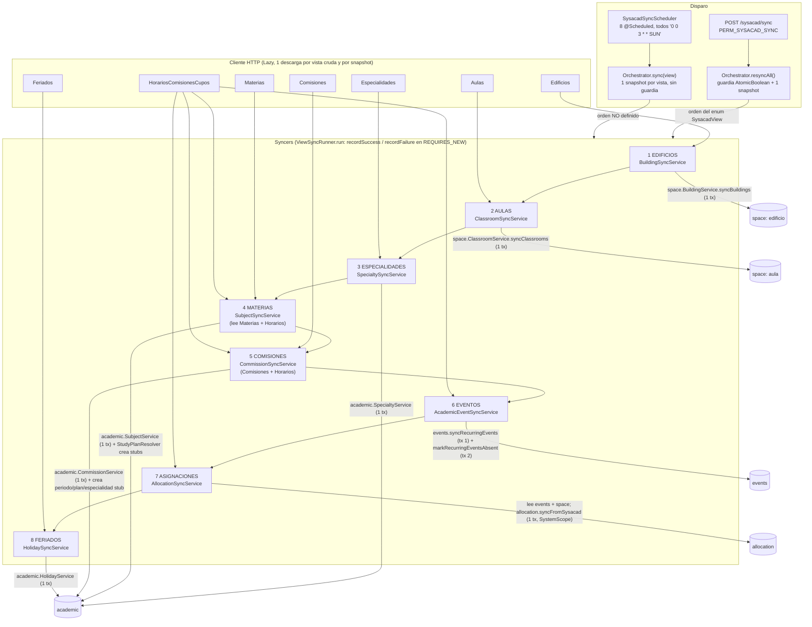

# Auditoría sysacad: correctitud, diseño y fronteras (10a)

Commit 22c693f2. Solo lectura, sin mvnw: `ModularityTests`, cobertura y PIT quedan para el hilo principal. La base `dev-snapshot` no respondió (no existe el socket de Docker), así que ningún hallazgo se apoya en datos vivos. `.claude/docs/sysacad-evidencias-computos.md` no está en el repo (está en la papelera del usuario), así que las cifras salen del documento del equipo y de los planes.

Rutas abreviadas: `S/` = `src/main/java/ar/edu/utn/frc/siga/sysacad/internal`, `C/` = `src/main/java/ar/edu/utn/frc/siga`.

## 1. Flujo del sync

Transacciones:
- Una por vista: cada `sync*` del núcleo es `@Transactional` y trabaja en bloque (lee todo, compara hash, escribe). Una fila que lance excepción deshace la vista entera, y `ViewSyncRunner` registra `recordFailure` en una transacción aparte.
- No hay transacción por fila ni por corrida. Una falla en la vista N deja las vistas 1..N-1 confirmadas y `resyncAll` sigue con N+1 (`SysacadSyncOrchestratorImpl:65-73`).
- EVENTOS usa dos transacciones (`AcademicEventSyncService:85` y `:91`). Si la baja falla después del upsert, el estado queda en error con los eventos ya escritos. Es idempotente, no daña.

Segunda corrida (idempotencia): ver SYS-QA-03 (comisiones), SYS-QA-04 (aulas `N`), E3 del plan para asignaciones y eventos. Edificios (código 1) reescribe 2 filas por corrida (caso 1). Materias, especialidades y feriados comparan hash y no escriben.

Concurrencia: `running` (`SysacadSyncOrchestratorImpl:24`) solo protege `resyncAll` contra `resyncAll`. El scheduler entra por `sync(view)` sin guardia. Ver SYS-QA-01.

## 2. Casos 1-8 del documento del equipo

| Caso | Dónde se pierde o transforma hoy | ¿El documento acierta? |
|---|---|---|
| 1 Edificios con código repetido | `C/space/service/impl/BuildingServiceImpl.syncBuildings:131-155`: `existing.get(code)` devuelve la entidad recién guardada, `isUpToDate` da falso (hash distinto) y la segunda fila pisa nombre y hash, con `affected++` por cada fila. El nombre final es el de la última fila. | Causa bien descrita. Omite que el hash alterna: en cada corrida siguiente las dos filas vuelven a escribirse (2 afectadas fijas). Su solución (`sysacad_origen`) quedó reemplazada por E2/E1 del plan (primera fila gana). |
| 2 Aulas con edificio ausente | `ClassroomServiceImpl.syncClassrooms:303-306`: `buildingsByCode.get` es nulo, WARN con edificio pero sin aula, `continue`. | Acierta, incluido el defecto del log. Cubierto por E1 (log con aula) y E2 (cadena de edificios). |
| 3 Materias repetidas | `C/academic/service/impl/SubjectServiceImpl.syncSubjects:105-125`, `groupBySourceKey` + `hasConflictingVariants`: copias idénticas se funden con WARN `copias=2`. | Acierta en que no se pierde nada. Falta decir que una variante con datos distintos (nombre o dictado) descarta la materia entera con un WARN (`:117`), sin crearla. |
| 4 Especialidades inventadas | `C/academic/service/impl/StudyPlanResolver.findOrCreate:36-44`: crea `Specialty` con nombre `"Especialidad N"` y `hash_sysacad` nulo; lo llaman `SubjectServiceImpl` y `CommissionServiceImpl.findOrCreateStudyPlan:~196`. Horarios no crea nada: solo lo usa para derivar el dictado. | Describe el comportamiento. No ve dos cosas: el stub con hash nulo no se marca `NOT_IN_SYSACAD` (se ve como especialidad normal) y prohibirlo corta la cadena Especialidad-Plan-Materia (el plan de integridad lo señala en "Contexto del sync, caso 4"). |
| 5 Vínculo materia-comisión | `CommissionServiceImpl.linkSubjectCommission:~214-224` (WARN con código de curso). La comisión se crea igual y habilitada (`:163-170`). El otro log, con id interno, está en `S/sync/SysacadCommissionResolver.resolveLink:63-65`. | Criterio de match descrito bien (`SubjectKey(código, planId)`). Se equivoca en el log: el que usa id interno es el del resolver, no el de comisiones. La regla "baja automática" no está implementada: la comisión nace habilitada. |
| 6 Horarios | Dos syncers distintos. ASIGNACIONES: `AllocationSyncService:73-75` (centinela), `:77-81` (sin link), `:86-91` (sin aula), `:99-103` (sin evento). EVENTOS: `AcademicEventSyncService:44-55` (sin link o sin duración). | Parcial. Dice que "eventos y asignaciones" se pierden por edificio o aula ausente, pero el evento no necesita aula: EVENTOS solo pierde filas por link (caso 5) o duración nula. Por edificio y aula se pierden solo asignaciones. |
| 7 Solapamientos | `AllocationSyncService.recordOverlap:131-136` + `OverlapKey:152` (edificio, aula, día, hora de comienzo, cuatrimestre). Solo WARN en `warnOverlaps:138-147`. | Acierta en el síntoma. La clave exacta por hora de comienzo no ve solapes por intervalo (el plan los cuenta: 221 pares no vistos, E10). Falta que dos filas con la misma clave de evento y aulas distintas no avisan: abortan la vista (SYS-QA-02). |
| 8 Logs y contadores | `ViewSyncRunner.run:22-31` solo registra `affected` y deja `lastError = null`. El 23 vs 22 sale de `BuildingServiceImpl:155`. Log sin aula: `ClassroomServiceImpl:305`. Log con id interno: `SysacadCommissionResolver:63-65`. | Acierta en los cuatro puntos. Su remedio (`sysacad_origen`) lo reemplazan E1 y E3. El 23 vs 22 es la misma raíz que el caso 1, no un contador aparte. |

## 3. Hallazgos

### SYS-QA-01 | Alta | Plausible (consecuencia), Confirmado (código)
**El cron lanza las 8 vistas por separado, sin orden de FK ni guardia, y puede solapar con el endpoint manual.**
- `application.yaml:190-197` fija el mismo cron `0 0 3 * * SUN` para las 8 vistas. `SysacadSyncScheduler:20-66` llama a `orchestrator.sync(view)` desde 8 métodos. El orden de ejecución con el mismo instante lo decide Spring y el pool por defecto, no el enum `SysacadView`. Si ASIGNACIONES corre antes que EVENTOS, los eventos nuevos de la semana no existen y la fila se saltea con WARN `No se encontró el evento`.
- `running` solo protege `resyncAll`. Un `POST /sysacad/sync` a las 3:00 del domingo o un resync largo (lectura de 120 s por vista) se pisan con el scheduler.
- La clave natural del evento recurrente no tiene índice único: no encontré ninguno sobre (materia, comisión, día, hora, fechas) en V1 a V26. Dos EVENTOS concurrentes pueden insertar el mismo evento dos veces. Después `AllocationSyncService:69-70` hace `Collectors.toMap` sin función de mezcla sobre `findSysacadRecurringEvents()` y lanza `IllegalStateException: Duplicate key` en cada corrida de ASIGNACIONES hasta que alguien limpie a mano.
- `resyncAll` ignorado devuelve `SUCCESS` (`SysacadSyncOrchestratorImpl:49-50`): el controlador responde 200 y no se distingue de una corrida buena (el OpenAPI lo documenta).
- Arreglo: un solo `@Scheduled` que llame `resyncAll()` (reusa orden y guardia) y un índice único sobre la clave natural del evento, con migración nueva que deduplique antes. Si hay más de una réplica, `AtomicBoolean` no alcanza (no medí el despliegue).

### SYS-QA-02 | Alta | Confirmado (código); frecuencia sin medir
**Una fila de Horarios con la misma clave de evento y aulas distintas aborta ASIGNACIONES completa.**
- `AllocationSyncService:107` arma `AllocationItem(evento, aula)`. El set deduplica pares idénticos, no eventos repetidos con aulas distintas. `C/allocation/service/impl/AllocationTargetResolver.resolveClassroomByOccurrence:35-39` lanza `AllocationConflictException` si la misma ocurrencia recibe dos aulas.
- `syncFromSysacad` es una transacción única (`AllocationServiceImpl:138`), así que ninguna de las ~62 mil asignaciones se escribe. Los duplicados exactos que el documento ya conoce (4 falsos solapes del caso 7) son inocuos solo si coinciden en aula.
- El `RawSchedule.comision` y el nombre de materia no entran en la clave, así que dos filas de la misma comisión y hora en aulas distintas (clase partida) caen aquí.
- Arreglo: detectar el conflicto en `AllocationSyncService` antes de llamar al servicio, conservar la primera, contar la incidencia (E1) y seguir.

### SYS-QA-03 | Media | Confirmado
**Una comisión con más de una materia se reescribe en cada corrida.**
- `CommissionServiceImpl.syncCommissions:150-175`: la clave de la comisión es (curso, período) pero el hash incluye `specialtyCode`, `studyPlanCode` y `subjectCode` de la fila. El view trae una fila por (curso, materia): con 2 materias la fila 1 compara contra el hash de la fila 2 de la corrida anterior, difiere, guarda y `affected++`; la fila 2 hace lo mismo. Pasa en todas las corridas para todo curso multi-materia (por ejemplo los 64 cursos de la especialidad 900 con materias 1 y 2).
- Efecto: `lastRowsAffected` de COMISIONES nunca baja a 0 y cada corrida genera un `UPDATE` (y revisión Envers cuando E4 audite `Commission`) por fila.
- El plan de integridad (regla transversal 4) da por hecho que comisiones "ya comparan contra hash": no es así para este caso. E3 debe incluirlo. Arreglo: sacar `subjectCode` del hash de la comisión (el vínculo materia ya se compara aparte en `linkSubjectCommission`).

### SYS-QA-04 | Media | Confirmado
**`habilitada_sysacad` de aula mezcla "habilitada = N" con "ausente del view", y ninguna de las dos cosas afecta la disponibilidad.**
- `SysacadCatalogMapper.toClassroom:49` convierte `habilitada` en booleano (`S` es verdadero; `N`, `null` y `" "` son falso, sin distinguir "desconocido").
- `ClassroomServiceImpl:369-371` define `isUpToDate` como hash igual y `sysacadEnabled == TRUE`. Un aula con `habilitada = N` queda `false`, así que `isUpToDate` siempre da falso: se reescribe y se cuenta en cada corrida (`:331-336`).
- `markAbsent:345` usa el mismo flag, por lo que "aula que Sysacad dejó de listar" y "aula listada como no habilitada" son indistinguibles en la base.
- `Classroom.unavailableReason():81-89` solo mira baja propia y edificio. Ninguno de los dos estados saca el aula de los candidatos (el plan lo reconoce para `N` en E11, pero no para las ausentes).
- Arreglo: guardar `habilitada` y "vigente en Sysacad" en columnas distintas, o no marcar ausencia en aulas (hoy no tiene efecto). La decisión de negocio (¿un aula que Sysacad quita debe dejar de ofrecerse?) hay que preguntarla; no la resolví con `business-rules`.

### SYS-QA-05 | Media | Confirmado
**EVENTOS marca como ausentes eventos que Sysacad sí lista cuando la fila se saltea por motivos locales.**
- `AcademicEventSyncService:44-55` hace `continue` si no resuelve comisión o link o si la duración es nula. Esas filas no entran en `presentEventIds`, y `markRecurringEventsAbsent:91` (`AcademicEventServiceImpl:422-436`) pone `habilitado_sysacad = false` a todo evento sysacad que no esté en el conjunto.
- Casos reales: curso con dos comisiones vigentes (`findActiveByCourseCode:117-131` lanza "no se puede resolver sin ambigüedad", por ejemplo en el cambio de año si Sysacad lista ambos), link no resuelto (caso 5), duración nula. El evento aparece como `NOT_IN_SYSACAD` y sale del dashboard (`DashboardReadRepository:62,78`) aunque Sysacad lo siga informando.
- Arreglo: separar "ausente en el origen" de "no resoluble hoy": solo marcar ausente lo que no aparece en el catálogo, no lo que se saltea. E1 cuenta la incidencia pero no cambia este efecto.

### SYS-QA-06 | Media | Confirmado en código; regla de negocio sin verificar
**Una asignación de origen SYSACAD nunca se libera.**
- `AllocationSyncService:73-75` salta las filas con aula 999 o 0 antes de tocar nada. `AllocationWriter.syncFromSysacad:80-105` solo crea o actualiza; no existe camino de borrado. Si Sysacad pasa una clase de un aula real al centinela, o la fila desaparece (evento ausente), la asignación vieja queda en el aula anterior.
- Efecto: el aula figura ocupada por una clase que Sysacad dice que no tiene aula. Pregunta para el usuario: ¿esa clase debe quedar sin aula (liberar) o conservar la última? El documento del equipo no lo define (el caso 6 dice que el centinela "no se toca"). El plan de integridad, regla 3, separa baja y liberación pero no trata este caso.

### SYS-QA-07 | Media | Plausible
**La guarda de "vista vacía" se aplica antes de validar filas, y la baja por ausencia usa solo las filas válidas.**
- `ViewSyncRunner.requireRows` revisa la lista ya mapeada. Si el origen cambia de forma (los `Raw*` usan `ignoreUnknown`, así que un campo renombrado llega como `null`) o responde con un volcado truncado, la lista no está vacía pero casi ninguna fila es válida.
- Edificios: `BuildingServiceImpl:127-129` descarta filas sin nombre y `markAbsent:164` marca ausentes todos los edificios que no están en `incoming`. Si `incoming` queda vacío, todos pasan a `NOT_IN_SYSACAD`, y con ellos aulas y asignaciones por cascada. Aulas (`ClassroomServiceImpl:345`) y comisiones (`CommissionServiceImpl:264`) se comportan igual.
- Arreglo barato: abortar si `incoming` queda vacío o por debajo de un porcentaje de lo existente. No hay dato real de que ocurra; el commit e8123f50 ya cubrió el caso "vacía".

### SYS-QA-08 | Media | Plausible
**El link materia-comisión de EVENTOS y ASIGNACIONES se resuelve sin especialidad ni plan y elige por id más bajo.**
- `SubjectCommissionServiceImpl.findByCommissionAndSubjectCode:73-75` usa `findFirst...OrderBySubject_IdAsc`. `SysacadCatalogMapper.toAcademicEvent` y `toAllocation` descartan `especialidad` y `plan` de la fila de Horarios.
- Si una comisión queda vinculada a dos materias del mismo código en planes distintos (el documento lista el código 519 faltante en 9 especialidades, lo que sugiere códigos compartidos), el evento se cuelga de la de menor id sin aviso. No pude verificarlo sin base: queda como duda de datos.
- Arreglo: pasar especialidad y plan al resolver y desambiguar, o loguear WARN si hay más de un candidato.

### SYS-QA-09 | Baja | Plausible
**Dictado de la materia: el 0 se trata distinto en eventos y en materias.**
- Eventos: `SysacadCommissionResolver.termTypes:78-90` expande el 0 en 1C y 2C. Materias: `SysacadCatalogSnapshot.semesterFromCommissions:154-161` descarta el 0 y el nulo; si todas las filas son 0 deja el dictado en `null` en vez de Anual, y si hay mezcla {0, 1} devuelve 1C.
- `MateriaDictado` vacío es el caso afectado (`resolveTerm:146-150`). Falta confirmar con negocio si 0 es anual para la materia.

### SYS-QA-10 | Baja | Plausible
**Un aula sin capacidad rompe AULAS entera.**
- `RawClassroom.capacidad` es `Integer` sin validar; `ClassroomServiceImpl:318-326` pasa `command.capacity()` a una columna `nullable = false` (`Classroom.java:44`). Un `null` falla el flush y deshace la vista, algo que el criterio "tolerar filas malas" (datos sucios de Sysacad) no admite. Arreglo: ignorar la fila con WARN, igual que con la clave incompleta.

### SYS-QA-11 | Baja (informativo) | Confirmado
**Fronteras de Modulith.**
- `sysacad` solo importa tipos con `@NamedInterface("api")` de `academic`, `space`, `events`, `allocation` (verifiqué `TermType`, `CommissionResponseDto`, `SubjectCommissionResponseDto`, los 5 servicios, `AllocationItem`/`AllocationTarget`, `SysacadRecurringEventRefDto`, `ClassroomResponseDto`, los 3 comandos de sync). Escribe solo por servicios públicos y comandos planos, sin entidades. Ningún otro módulo importa `sysacad`. `common` y `audit` son dependencias declaradas. Falta confirmar con `ModularityTests`.
- El núcleo conoce Sysacad: `hash_sysacad`, `habilitado_sysacad`, `NOT_IN_SYSACAD` y `Classroom.isCurrentInSysacad` en 26 archivos (R1 parcial, ya documentado), más métodos y tipos con nombre de origen: `AllocationService.syncFromSysacad`, `AllocationSource.SYSACAD`, `AcademicEventService.findSysacadRecurringEvents`/`markRecurringEventsAbsent` y `SysacadRecurringEventRefDto` en `events.api`. Ninguno es nuevo en este diff ni lo agrega E2; la regla "nada nuevo en el núcleo" se mantiene hoy. `StudyPlanResolver` mete lógica de stub de Sysacad en `academic` (E2 de arquitectura no lo toca).

### SYS-QA-12 | Baja | Confirmado
**Sobre-ingeniería (criterio `ponytail-audit`).** Sin comentarios `ponytail:` en `sysacad` (`ponytail-debt` devuelve 0).
- `delete`/`yagni`: `S/client/ViewQuery.java` (filtros, orden, dirección, límite) y las ramas de `SysacadClient.buildUri:65-79` nunca se usan: los 7 fetchers llaman `ViewQuery.none()`.
- `delete`: `SysacadSyncStateService.ensureExists` + `SysacadSyncStateServiceImpl.seedStates` (`@PostConstruct`) + `findOrCreate` en `recordSuccess`/`recordFailure` + el bucle del controlador (`SysacadSyncController:45-47`). Tres mecanismos para el mismo fin; con el seed al arrancar, el bucle y `ensureExists` sobran.
- `shrink`: 7 `*ViewFetcher` idénticos salvo nombre de vista y tipo; una sola clase con el mapa vista a tipo alcanza.
- `shrink`: cada vista pasa por Raw, Dto y Command (`SysacadBuildingDto` y `BuildingSyncCommand` tienen los mismos campos). Reducible a dos capas con una sola frontera.
- Estilo: `SysacadCatalogMapper` copia campo a campo cinco de sus ocho métodos a mano; el proyecto pide MapStruct (`componentModel = SPRING`). Solo los que parsean (fechas, hora, día) justifican código manual.
- Menor: `SysacadCatalogSnapshot.findAcademicEvents` y `findAllocations` vuelven a mapear las mismas filas, y cada fila mala loguea dos WARN.

### SYS-QA-13 | Baja | Confirmado
**Identificadores fuera de inglés.** `RawSchedule`/`RawCommission`/`RawSubject`: componentes `especialid`, `anoacademi`, `horarioCuatrimestre`, `materiaDictado`, `edificioNombre` (renombrables con `@JsonProperty`). `SysacadCatalogSnapshot`: `SubjectNaturalKey(especialidad, plan, materia)` (`:172`), variable `cuatrimestrales` (`:155`). `SysacadCatalogMapper`: variables `curso`, `horaComienzo`, `horaFin`. Los valores del enum `SysacadView` (`EDIFICIOS`, `ASIGNACIONES`...) están en español y se persisten en `sysacad_sync_state` y salen por la API; cambiarlos exige migración y aviso al frontend, no lo propongo.

## 4. Cobertura de los planes vigentes
- Cubierto por E1: logs con clave de la fila (casos 2, 8), contadores por motivo.
- Cubierto por E2: cadena de edificios (casos 1, 2, 6 parcial).
- Cubierto por E3: contador de asignaciones y de eventos. Falta sumar comisiones (SYS-QA-03) y aulas `N` (SYS-QA-04).
- Cubierto por E10: solapes por intervalo (caso 7).
- Sin cubrir: SYS-QA-01, 02, 05, 06, 07, 08, 10.

## 5. Conteo
Alta 2 (01, 02). Media 6 (03, 04, 05, 06, 07, 08). Baja 5 (09, 10, 11 informativo, 12, 13). Total 13.

## Preguntas para el usuario
1. SYS-QA-06: cuando Sysacad pasa una clase al aula centinela (999 o 0) o la fila desaparece, ¿la asignación SYSACAD previa se libera o se conserva?
2. SYS-QA-04: un aula que Sysacad deja de listar o marca `habilitada = N`, ¿debe dejar de ofrecerse como candidata?
3. SYS-QA-09: ¿`HorarioCuatrimestre = 0` significa dictado anual de la materia?
